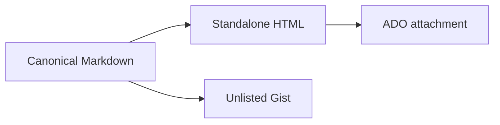
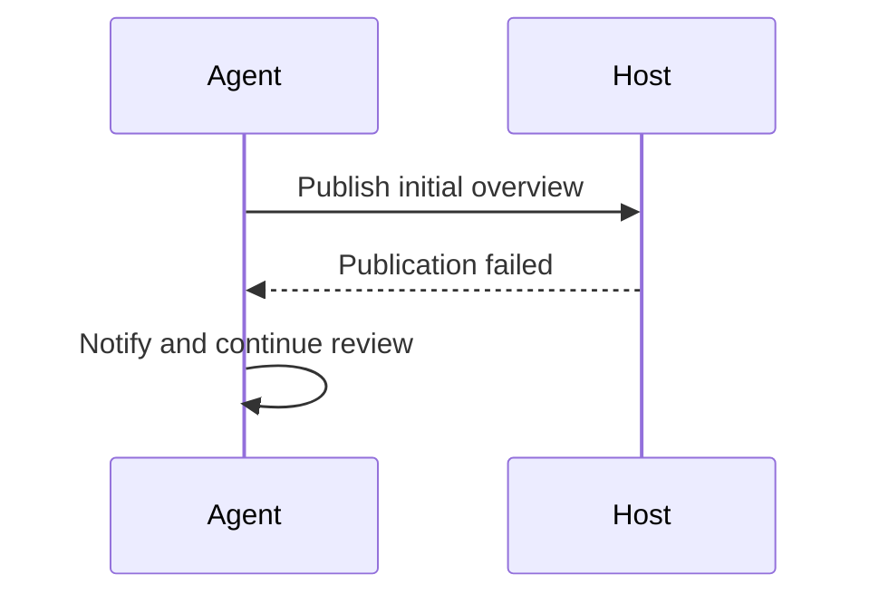

# Review presentation fixture

## Mission

Preserve **formatted prose**, `literal code`, and [source references](https://example.invalid/source).

## Mechanism





| Input | Presentation |
| --- | --- |
| Markdown | HTML or rendered Gist |
| Mermaid | Embedded SVG or native Gist diagrams |

## Finding F1

Literal raw markup stays visible: <script>alert("not executable")</script>.

```powershell
$value = '<script>code sample</script>'
Write-Output $value
if (one == 1) {
    onClick = "literal code"
}
```

## Mechanism

Duplicate headings must still receive distinct table-of-contents targets.

[A repository-local reference](docs/design.md) remains visible without linking to the session directory.

> - Outer list
>   - Second list
>     - Third list
>       - Fourth list
>
>         | Nested table | Reference |
>         | --- | --- |
>         | `literal code` | [Link](https://example.invalid/reference) |
